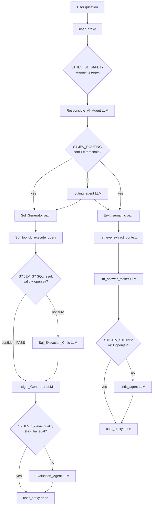

# AURIX — OpenJev (JEV) architecture

OpenJev is wired only for **discriminative decisions**: safety scores, route labels (SQL vs semantic), SQL result validity, evaluation pass/skip, and answer grounding. It calls the Codiv `/v1/systemone` API (`JEV_API_BASE`, `JEV_API_KEY`) and returns probabilities, choices, and booleans. **JEV never generates natural-language answers, T-SQL, or retrieval results.** Sql_Generator (Azure OpenAI) writes SQL; `db_execute_query()` runs it; `extract_context()` calls Azure AI Search / GraphRAG; Insight_Generator and llm_answer_maker (Azure OpenAI) produce answers.

## Pipeline (core JEV gates only)

## Node reference

| Node | Who does the real work | What JEV decides | Flag | Status |
|------|------------------------|------------------|------|--------|
| Input safety | Regex + Responsible_AI_Agent | Toxic / PII / injection scores (augments regex) | `JEV_S1_SAFETY_ENABLED` | **Core: ON** |
| Routing | `routing_agent` (LLM) | SQL vs semantic route | `JEV_ROUTING_ENABLED` | **Core: ON** |
| SQL execution | `db_execute_query` → `fetch_dataframe_readonly` | — (optional S6 guard) | `JEV_S6_SQL_GUARD_ENABLED` | Optional: OFF |
| SQL result critic | `Sql_Execution_Critic` (LLM) | Result valid vs error type | `JEV_S7_SQL_RESULT_ENABLED` | **Core: ON** |
| SQL evaluation | `Evaluation_Agent` (LLM) | Skip heavyweight eval | `JEV_S9_EVAL_ENABLED` | **Core: ON** |
| Semantic critic | `critic_agent` (LLM) | Grounded / no hallucination | `JEV_S13_CRITIC_ENABLED` | **Core: ON** |
| Clarity / cache / model / retrieval / chart / output / ingest | Azure LLM or tools | Micro-decisions (see tracker) | S2, S3, S5, S6, S8, S10–S12, S14, S15 | Optional: OFF |

## Azure endpoint (AutoGen / OpenAI)

- **Configured host:** `https://aipractices.cognitiveservices.azure.com/` in `.env` (`AZURE_OPENAI_API_BASE`); `GRAPH_API_BASE` empty → same as main.
- **DNS alias:** `install_openai_dns_alias_patch()` in `azure_openai_endpoint.py` — if `*.openai.azure.com` does not resolve, sockets use `*.cognitiveservices.azure.com` (name resolution only; **401/403 are not masked**).
- **Per request:** `refresh_azure_openai_runtime()` in `get_final_answer()` updates `llm_config` and the embedding client.
- **Streamlit:** `main.py` uses `_aurix_cache_token()` + `importlib.reload(API_unified)` and `importlib.reload(aurix_core)` so backend and `.env` changes apply without stale module state.

## Configuration

- Flags are read in `API_unified.py` at import (`.env` loaded once with `override=False`). After a `.env` edit, restart the Python process or change `.env` mtime so Streamlit’s cache token reloads modules.
- JEV uses **Codiv only** (`JEV_API_BASE`, `JEV_API_KEY`) — not Azure OpenAI endpoints.